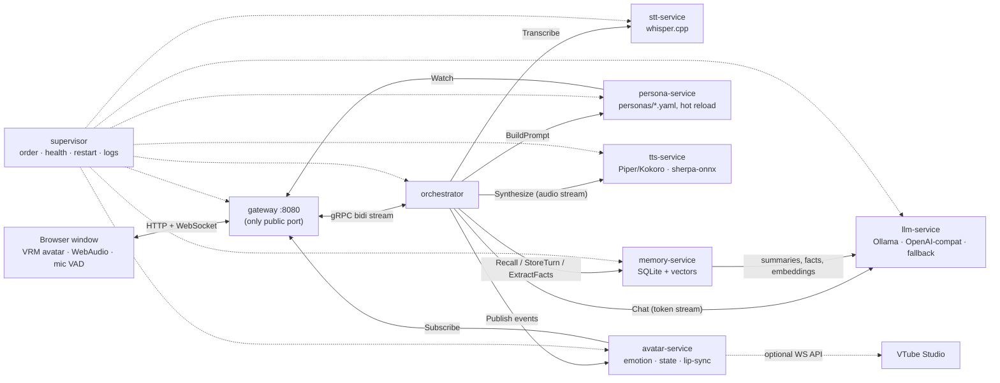
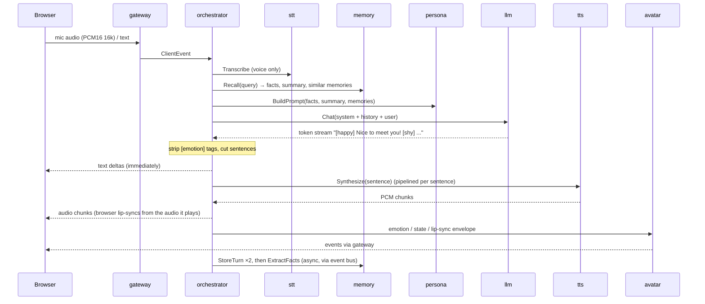

# Waifu - a local voice companion with an avatar, personality, memory and voice

100% Rust backend (microservices over gRPC), lightweight TypeScript frontend, **no Docker, no API keys, no accounts**.
Talk to **Mio** (or your own character): she hears you (whisper.cpp), remembers you (SQLite + embeddings), thinks
(Ollama / any OpenAI-compatible API), speaks (Piper via sherpa-onnx) and shows emotions on a VRM avatar with lip-sync.

## Run it

| OS | Command |
|---|---|
| Windows | double-click / run `run.bat` |
| Linux / macOS | `./run.sh` |

The script installs missing build tools (Rust via rustup; on Windows also VS C++ Build Tools, CMake, LLVM via `winget`),
builds in release mode, downloads models (Whisper, Piper voice, VRM avatar, an Ollama model if Ollama is installed),
starts all services under the supervisor and opens the avatar window. First run is slow (compiling whisper.cpp). 
Flags: `--no-open`, `--small` (force the smaller Whisper model). Stop with Ctrl+C.

For real conversations install [Ollama](https://ollama.com) (`winget install Ollama.Ollama`) *before* running; the script
then pulls the model named in `config/settings.yaml` (`llm.model`, `gemma3:4b` by default). Without Ollama she still answers from a tiny built-in
fallback brain, and tells you so.

Optional: `docker compose -f deploy/docker-compose.yml up --build` (see `deploy/`; includes an Ollama container).

## Loading screen

`run.sh` / `run.bat` first build a tiny **dependency-free launcher** (`backend/tools/launcher`, ~1 s) and open the window with it, so
you see what is happening instead of a blank terminal: *compiling* (crates done, crate in progress), *downloading models*
(file / Ollama model), *building the interface*, then one row per service with what it is loading right now
(*"loading the voice model"*, *"warming up the language model"*, ...). When every service is ready the page hands over to the
app automatically. If the launcher cannot be built, everything works as before without it.

* The launcher only reads files in `data/boot/` (`phase.txt` from the scripts, `build.log`, and `services.json` written by the
  supervisor) and serves them on `http://127.0.0.1:8079`. It exits shortly after the app is ready.
* Any service can take part: print `@@loading <what>` on stdout while warming up and `@@ready` when done (or `@@failed <why>`).
  The supervisor waits for `@@ready` (up to the service's `startup_timeout_s`) before declaring start-up finished.
* The supervisor now starts **all services at once** (they connect lazily); `--sequential` restores the old dependency waves.

## Latency: where the time goes and what is tuned

| stage | what was slow | what is done now |
|---|---|---|
| end of your speech | VAD waited 900 ms of silence, judged energy from one 2.7 ms block | 450 ms (tune: `localStorage['waifu.vad_hangover_ms']`), 32 ms frames, energy over the whole frame, 96 ms onset |
| memory / persona | recall retried with sleeps (up to ~1.7 s) | one short attempt (`memory_ms: 400`, `persona_ms: 300`); a slow answer is not reported as "offline" |
| first LLM token | model loaded on the first message, unloaded after 30 min, prompt evaluated from scratch | start-up **prewarm** loads the model and prefills its cache with the real persona prompt (`orchestrator.settings.prewarm`); `keep_alive: 24h` |
| fact extraction | a 2nd LLM call right after every reply, competing with your next message | runs only after 2 s of quiet and is cancelled the moment you talk again |
| first audio | Chatterbox generated the whole sentence first; first reply paid for loading `ref.wav` | after an idle gap the first clause is cut to ~40 chars (`CB_FIRST_CHARS`, 0 = off); all voices are prepared at start-up and cached; FIFO queue; abandoned requests stop before the next clause |
| speech recognition | first inference initialised lazily | warm-up inference at start-up |
| start-up | sequential waves, 250 ms health polling, `ollama pull` + `sleep 3` on every launch | parallel start, 100 ms polling, pull only if the model is missing, wait for Ollama by polling |

## Architecture



One conversation turn:



* **Contracts first**: all APIs are in `backend/crates/contracts/proto/*.proto` (tonic/prost; protoc is vendored, nothing to install).
* **Event bus** (`backend/crates/common/src/bus.rs`): in-process `broadcast` by default; mirrored to NATS if built with
  `--features nats` and `global.bus: nats`. The orchestrator publishes `UserSpoke`, `EmotionChanged`, `TurnCompleted`,
  `Interrupted`; reactors forward emotions to the avatar-service and trigger fact extraction without blocking the reply.
* **Trace ids**: minted per turn, propagated in gRPC metadata `x-trace-id`, present on every log line of that turn in every service.
* **Metrics**: `GET http://127.0.0.1:910x/metrics` per service (Prometheus text); health: `/healthz`. The gateway serves both on :8080.

## Service map (`config/services.yaml`)

| role | binary | gRPC | health/metrics | default implementation |
|---|---|---|---|---|
| gateway | `gateway` | - (HTTP :8080) | :8080 | axum, static files, WS |
| orchestrator | `orchestrator` | 50051 | 9101 | pipeline, interruption |
| llm | `llm-service` | 50052 | 9102 | Ollama → fallback brain; OpenAI-compatible optional |
| stt | `stt-service` | 50053 | 9103 | whisper-rs |
| tts | `backend/engines/chatterbox-tts` (Python) | 60001 | - | Chatterbox Turbo (F5-TTS in `backend/engines/f5-tts` and builtin Piper `tts-service` selectable with `tts.engine`), streamed per clause |
| memory | `memory-service` | 50055 | 9105 | rusqlite + local embeddings |
| persona | `persona-service` | 50056 | 9106 | `config/personas/<name>.yaml`, mtime-polled hot reload |
| avatar | `avatar-service` | 50057 | 9107 | event hub + optional VTube Studio bridge |

## How to change X (no code changes)

Almost everything is in **`config/settings.yaml`** (every key optional, typos rejected on start, applies on restart).
Full guide with recipes: [`docs/CONFIGURATION.md`](docs/CONFIGURATION.md).

| I want to change... | Do this |
|---|---|
| **LLM model** | `ollama pull <model>`, then `llm.model: <model>` in `settings.yaml`. (`auto` = first installed of `model_candidates`; `WAIFU_LLM_MODEL` env beats everything.) |
| **LLM provider** | `llm.provider: openai` + `openai_base_url` / `model` (LM Studio, llama.cpp server, vLLM, OpenAI...). Key: set the env var named by `openai_api_key_env`. |
| **Voice** | drop `assets/voices/<name>/ref.wav` (Chatterbox/F5) or a Piper/Kokoro folder (see `assets/voices/README.md`), set `tts.voice: <name>` (blank = the persona's own `voice`). |
| **TTS engine / device** | `tts.engine: chatterbox \| f5 \| piper`, `tts.device: auto \| cpu \| cuda \| mps`, `tts.python: <interpreter>`. |
| **Avatar** | drop a `.vrm` into `assets/avatars/`, set `avatar.file: name.vrm` (or pick it in the header drop-down). |
| **Personality / name / backstory / rules** | edit `config/personas/<name>.yaml` while running (hot-reloaded). Another character: add a file, set `persona: <name>`. |
| **Speech recognition** | drop `ggml-*.bin` into `assets/models/`, set `stt.model` and `stt.language`. |
| **Memory behaviour** | `memory.embedder: llm` for semantic recall (needs `ollama pull nomic-embed-text`), `summarize_after`, `keep_recent`. |
| **VTube Studio** | `avatar.vtube_studio.enabled: true`, enable the plugin API in VTube Studio, approve the popup on first connect (token saved to `data/vts_token.txt`), map `emotion_hotkeys` in `services.yaml`. |
| **Emotion -> face mapping, idle motion** | `frontend/src/avatar.ts` (`EMOTIONS` table), then `cd frontend && npm install && npm run build`. |
| **Replace any service (any language)** | `impl: external` + `addr` (+ optional `command`) in `config/services.yaml` -> `docs/CUSTOM_SERVICE.md`, template in `backend/engines/template-python/`. |
| **Ports / addresses** | `config/services.yaml`; or env `WAIFU_ADDR_<ROLE>=host:port`, `WAIFU_HTTP_<ROLE>=host:port`. |
| **Log format / level** | `log_level` in `settings.yaml`, `RUST_LOG`, `LOG_FORMAT=json`. |

## Resilience & graceful degradation

Timeouts on every call, retries on reads, a circuit breaker per downstream, lazy gRPC channels (start order does not matter),
supervisor auto-restart with exponential backoff (1 s → 30 s), hung-service detection (5 failed health checks).

| Failure | Behaviour |
|---|---|
| no microphone / permission denied | mic button hides, toast, **text chat** continues |
| no Whisper model / stt down | status shows `stt: degraded`; voice input answers "unavailable, type instead" |
| no GPU | `run.*` pick `ggml-tiny.en` and `qwen2.5:1.5b` |
| Ollama down / model missing | **clear notice** with the fix (`ollama serve` / `ollama pull X`), automatic fallback to the built-in brain; breaker avoids hammering |
| LLM chain exhausted | spoken + written apology, error notice; conversation not stored |
| memory-service down | notice, chat continues without memory (no crash, no hang: 2.5 s deadline + breaker) |
| persona-service down | built-in default prompt + notice |
| tts down / no voice | text-only reply + notice; no voice folder → babble voice so lip-sync still works |
| avatar-service down | gateway falls back to the orchestrator's own emotion/state events |
| orchestrator down | gateway tells the browser and reconnects automatically |
| bad persona file edit | previous persona kept, service reports `degraded` |

## Quality gate

`scripts/test.sh` = `cargo fmt --check`, `cargo clippy -D warnings`, unit tests of every service, the toolchain-free tests (Chatterbox latency logic: `python3 -m unittest discover -s backend/engines/chatterbox-tts`; VAD + loading-screen logic: `node --test frontend/test/vad.test.ts backend/tools/launcher/test/splash.test.mjs`), and the **end-to-end test**
(`backend/e2e/tests/pipeline.rs`): starts the real supervisor + 8 real binaries (+ a mock OpenAI-compatible LLM) and drives the gateway
over WebSocket like the browser: streaming, tag stripping, real Piper audio, memory → persona → LLM, voice-input path,
barge-in, killing a service mid-session, persona hot reload, metrics, graceful shutdown.
`WAIFU_E2E_EXTERNAL_TTS=1 cargo test -p e2e` repeats it with the **Python** TTS swapped in via config only.

## Decisions I made where the brief was open

* **Avatar = VRM (three-vrm)**, not Live2D: Live2D needs the proprietary Cubism Core runtime; VRM is fully open. Default model Seed-san (CC0).
* **Local embeddings = built-in feature-hashing** by default (instant, zero downloads, keyword-ish recall); optional semantic mode via Ollama `nomic-embed-text`. Vector search is brute-force cosine over ≤5000 recent rows - fine at personal scale.
* **TTS = Piper (VITS) through sherpa-onnx** (`sherpa-rs`), Kokoro supported by dropping a Kokoro folder in `voices/`. Synthesis is per sentence (sherpa returns whole utterances), chunked to 200 ms for streaming.
* **STT = whisper-rs, utterance-based** (browser VAD cuts utterances; no partial transcripts).
* **Lip-sync**: the browser drives the mouth from an analyser on the audio it actually plays; the orchestrator also sends an RMS mouth envelope to avatar-service for external avatars (VTube Studio).
* **Hot reload by polling mtime** (works on every OS and on Docker bind mounts).
* **Cross-process events**: gRPC for service-to-service; the bus itself is in-process (+ optional NATS), so reactors live in the orchestrator.
* **Graceful stop on Windows** (no SIGTERM): supervisor calls `POST /admin/shutdown` (loopback-only) on each service, then force-kills after 6 s.
* **External services** are health-probed by TCP connect only.
* The default fallback "brain" is a few rules, deliberately tiny - it exists so the app never goes mute, not to replace an LLM.
* OpenTelemetry export is not included (logs carry trace ids; the metrics endpoint is Prometheus-compatible).

## What has and has not been verified

Verified on Linux (1 CPU / 3 GB sandbox): everything in "Quality gate" (48 tests), plus a live run of the **release** build under the supervisor:
all 8 services start in dependency order, text + real Piper speech (~0.3 s to first audio on CPU), facts persisted in SQLite,
SIGKILL of tts / memory / llm → clear notices, conversation continues, supervisor restarts them within ~1 s, Ctrl+C stops all
services gracefully in ~2 s. The frontend typechecks and bundles; the gateway serves it, the persona, the VRM file and the API.

**Not verified** (be aware when you first run it):
* real Ollama conversations and Whisper accuracy (no access to those hosts from the sandbox; the Whisper load/inference code path was exercised with a stub model only);
* the avatar's actual rendering in a browser (no browser was available). I did check the default model's data: it is VRM 1.0, T-pose, has every expression/bone the code uses, and the arm-lowering signs and camera framing were derived from its real bone positions - but other VRMs, or visual taste, may need tweaks in `frontend/src/avatar.ts` (`ARM_DOWN`, camera position);
* microphone capture + VAD tuning in a real browser (thresholds in `frontend/src/audio.ts`);
* `run.bat` and the Windows toolchain auto-install, `run.sh` on macOS, the PowerShell downloader, Docker/compose, the NATS feature, and the VTube Studio bridge against a real VTube Studio.

## Project layout

```
waifu/
├── run.sh · run.bat            one-command launch (build, download models, start everything)
├── README.md
├── Cargo.toml · Cargo.lock     Rust workspace root (members live in backend/)
│
├── config/                     ── everything you edit ──
│   ├── settings.yaml           ★ model, voice, avatar, persona, TTS engine, STT, memory
│   ├── services.yaml           wiring: ports, binaries, TTS engine catalogue (advanced)
│   └── personas/               one YAML per character (hot-reloaded)  mio.yaml · aria-sage.yaml
│
├── assets/                     ── things you drop in (big files, not in git) ──
│   ├── avatars/                .vrm models
│   ├── voices/                 <name>/ref.wav  (or Piper/Kokoro folders)
│   └── models/                 whisper ggml-*.bin
│
├── frontend/                   TypeScript UI (VRM avatar, mic VAD, WebAudio)  src/ → dist/
│
├── backend/
│   ├── crates/
│   │   ├── contracts/          .proto files + generated gRPC code
│   │   └── common/             config + settings overlay, telemetry, health, breaker, bus, audio
│   ├── services/               Rust gRPC services
│   │   └── gateway · orchestrator · llm-service · stt-service · tts-service · memory-service · persona-service · avatar-service
│   ├── engines/                Python TTS engines (started by the supervisor, same gRPC contract)
│   │   └── chatterbox-tts · f5-tts · template-python (copy it to write your own)
│   ├── tools/
│   │   ├── supervisor/         starts, health-checks and restarts all services
│   │   └── launcher/           the loading screen shown while it builds / starts
│   └── e2e/                    end-to-end test with the real binaries
│
├── scripts/                    download-models.{sh,ps1} · test.sh
├── deploy/                     Dockerfile · docker-compose.yml (optional)
├── docs/                       CONFIGURATION.md · CUSTOM_SERVICE.md
└── data/                       runtime state (memory.sqlite, boot status) - created on first run, not in git
```

Rule of thumb: **change behaviour in `config/`, add files to `assets/`, write code in `backend/` or `frontend/`.**

## Troubleshooting
* *"binary … not found"*: run `cargo build --release --workspace`.
* *No voice input*: check the `stt` dot in the header / `curl :8080/api/status`; put a model in `assets/models/`.
* *Microphone blocked*: browsers allow it only on `http://localhost` or https - open `http://127.0.0.1:8080` / `localhost`, not a LAN IP.
* *Avatar missing*: put a `.vrm` in `assets/avatars/`; check the browser console.
* *Linux build fails in `whisper-rs-sys`/`sherpa-rs-sys`*: install `cmake clang libclang-dev` (run.sh does this).
